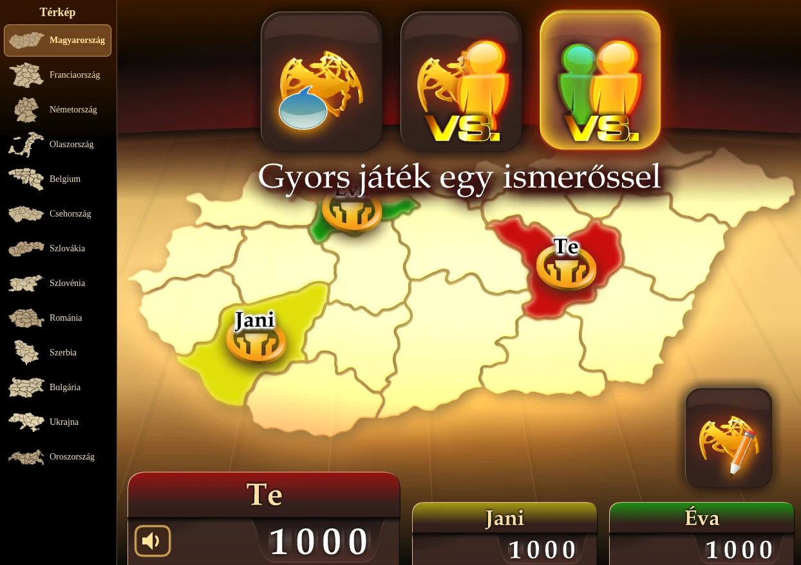

# Honfoglaló – a régi próbajáték, többjátékos móddal

A honfoglalo.hu 2009–2013-as Flash próbajátéka **az eredeti SWF-fel**, a [Ruffle](https://ruffle.rs)
Flash-emulátorban, egy kis Go szerverrel a többjátékos szobákhoz.

Játszható: <https://honfoglalo.online>



## Indítás

Go 1.22 vagy újabb kell hozzá. A projekt mappájából:

```bash
go run ./server
```

Utána: <http://localhost:8765/>. Teszt: `go test ./server`; terhelésteszt: `tools/loadtest/main.go`.

## A játék

- **Bemutató játék:** az eredeti oktató játék.
- **Játék robotokkal:** teljes játék Jani és Éva ellen, élesben számoló órával.
- **Játék ismerősökkel:** szoba létrehozása vagy csatlakozás (lent).
- **Visszajelzés:** rövid üzenet a szervernek.

Az oldal bal sávjában (telefonon a „Menü” fül alatt) választható a térkép: a SWF mind a 13 országa
játszható. Ugyanott a szabály is (az „i” jel elmagyarázza):

- **Villámháború** (a próbajáték szabálya): a bázisokat a gép sorsolja, 4 harci kör, az utolsóban a
  pontok sorrendjében bárhová lehet támadni.
- **Hosszú hadjárat:** nincs sorsolás, a játékosok véletlen sorrendben maguk választják ki a
  kezdőterületüket (a bázisukat); 6 harci kör, fix sorrendben (mindenki minden helyről egyszer
  támad), és csak az utolsó körben lehet bárhová támadni.

A szabály a robotos és a többjátékos játékra vonatkozik, a bemutató mindig villámháború. A játék végén
egy eredményablak mutatja a helyezéseket és a saját statisztikádat.

## Többjátékos játék

- Szoba létrehozásához csak név kell; a szobakódot vagy a meghívó linket (`?join=KÓD`) kell elküldeni.
  Legfeljebb 3 játékos, a főnök indít. Az üres helyre a főnök robotot tehet (Jani, Éva), és ki is
  veheti; ha nincs üres hely, a belépő a robot helyére ül. Már ketten is indíthatnak (két ember, vagy
  egy ember és egy robot): a harmadik hely ekkor kimarad a játékból (nincs bázisa, nem tippel, nem
  támad, nem is támadható). Ha a létrehozó az első játék előtt kilép (vagy bezárja a lapot), a szoba
  megszűnik; egy böngészőből egyszerre legfeljebb 2 szoba lehet nyitva.
- A játék végén a **Vissza a váróba** gombbal a szoba újra várakozik, a főnök új játékot indíthat; a
  **Kilépés** a főoldalra visz.
- **Publikus váró:** létrehozáskor bejelölhető, ekkor neve is van (alapból „Név lobbyja”). A jobb oldali
  **Várók** listájában (telefonon a „Várók” fül alatt) bárki látja a létrehozás idejével, és kód
  nélkül beléphet. A megtelt szobák és a futó játékok (hogy hol tartanak) halványan, a lista végén
  látszanak, a „Csak ahová be lehet lépni” négyzettel el is rejthetők; a játék után a váróba
  visszatérve ugyanaz a szoba marad. A lista fejléce mutatja, hányan vannak most a honlapon.
- **Csevegés:** a szobában (a játék előtt és alatt is), a Várók alatt (telefonon a játék alatt). A
  trágár szavakat a szerver kicsillagozza (magyar és angol szólista, `server/profanity.go`), linket
  (rövidet sem) nem enged. Ugyanazt az üzenetet nem lehet rögtön újra elküldeni, és aki túl sűrűn ír,
  vagy túl sűrűn rakosgatja ki-be a robotot, egy ideig nem teheti (`server/lobby.go`: `chatFlood`,
  `robotFlood`). Az X-szel ki lehet lépni belőle; a belépést a szobába (ugyanazt a nevet 10 mp-en
  belül csak egyszer) és a csevegésből való ki- és visszalépést, a robotok be- és kivételét mindenki
  látja, minden sor az idejével. A hang ereje a játékéval együtt állítható.
- Minden gépen ugyanaz az eredeti játék fut. A véletleneket és a döntéseket egy gép dönti el, és a
  szerver mindenkinek ugyanabban a sorrendben küldi el.
- Aki kilép vagy elmegy a kapcsolata, helyette robot játszik: a neve mögött „(robot)” áll, amíg
  vissza nem tér, és ezt a többiek a játékban és a csevegésben is látják. Aki nem lép időben (rossz kapcsolat, háttérbe tett lap), arra
  a játék az órája lejárta után pár másodpercig vár, utána nélküle megy tovább (lejárt időnek számít).
  Frissítéskor a játék visszaviszi a helyére, és pár másodperc alatt felzárkózik. Másik gépről a
  szobakóddal és ugyanazzal a névvel lehet visszalépni.

A szerver (`server/`) a szobákat a memóriában tartja, adatbázis nincs; a játékosok Server-Sent
Events folyamon kapják az eseményeket. IP-nkénti korlátok védik (`server/limits.go`).

## Kérdések

A `questions.xml`-ben 1000 feleletválasztós és 1000 tippkérdés van, nyolc kategóriában (földrajz,
sport, irodalom, művészet, természettudományok, matematika–fizika, életmód, szórakozás), mindegyikben
125–125, és nehézségenként (könnyű, közepes, nehéz) nagyjából egyharmad. A játék előbb kategóriát
sorsol, aztán kérdést; egy játékon belül nincs ismétlés. A böngésző megjegyzi a látott kérdéseket, és
előbb a még nem látottak jönnek; többjátékosban a szoba minden játékosáé számít (azok jönnek előbb,
amelyeket a legkevesebben láttak).

| Forrás                           | Feleletválasztós | Tipp | Összesen     |
| -------------------------------- | ---------------: | ---: | -----------: |
| Beküldött (javított)             |              334 |  857 | 1191 (~60%) |
| A próbajáték eredeti kérdései    |               56 |   38 |    94 (~5%) |
| AI-val írt                       |              610 |  105 |  715 (~36%) |

A beküldött kérdéseket [u/GrindChess](https://www.reddit.com/r/programmingHungary/comments/1x557z1/comment/pgjnd8i/)
küldte az r/programmingHungary-n – innen is köszi! Helyesírásilag javítva, a válaszokat ellenőrizve
kerültek be.

A források: `questions_2013.csv` (a próbajáték eredeti kérdései) és `questions_extra.csv` (beküldött
és AI-val írt kérdések; a végén a kikapcsolt tartalékkal). Új kérdések felvétele és a
`questions.xml` újraépítése:

```bash
python3 tools/import_questions.py kerdesek.csv
```

```bash
python3 tools/import_questions.py --rebuild
```

CSV-sorok: `# kategória: Sport`, `# nehézség: közepes`, `kérdés;helyes;rossz;rossz;rossz`
(feleletválasztós) vagy `kérdés;szám;min;max` (tippkérdés).

## Hangok

Az eredeti hangfájl elveszett; a `sounds/` mappában a játék hangneveire átnevezett pótlások vannak.
Egy hanghoz elég a fájlt `<hangnév>.mp3` néven a mappába tenni; ha egy hang más nevű fájlt kap, azt
a `sounds/manifest.json` adja meg. Hiányzik: `host_tiktak_3`.

## Mi változott az SWF-ben

A `swf/testclient.swf`-et a `tools/patch_swf.py` állítja elő az eredetiből; a grafika és a szabályok
nem változtak. A kiegészítések ActionScript-forrásként a `src/` mappában vannak:

- `src/core.as` – hang- és hálózati híd az oldal felé
- `src/tweaks.as` – menü, robotjáték, hangok, tippkártyák
- `src/lobby.as` – a Flash-ablakok (szoba, visszajelzés, hangerő, eredmény, várakozó doboz)
- `src/questions.as` – kérdésválasztás
- `src/mp.as` – a többjátékos szinkron

Teszteléshez: `?debugclock=3` (rövid óra), `?slot=a` (külön munkamenet), `?debug`, `?map=FR`,
`?long=1` (hosszú hadjárat), `?touchtext` (a telefonos beviteli mező asztali gépen is).

## Források

Az eredeti anyag a web.archive.org-ról van: a próbajáték (`honfoglalo.hu/swf/testclient.swf`,
2011), a kérdései (2009, 2013), a feliratok (`dat/lang.json`, 2013) és a 2004-es teljes kliens. A
`tools/fetch_archive.sh` mindent újra letölt, a `tools/fetch_ruffle.sh` a Ruffle-t.

## Licenc

A projekthez írt kód és szöveg MIT-licencű ([LICENSE](LICENSE)). Az eredeti Honfoglaló-anyag (az
SWF-ek és a belőlük készült fájlok, `archive/`, `dat/lang.json`, `questions_2013.csv`, `sounds/`,
`favicon.ico`, `img/bg.png`) a jogtulajdonosoké marad; a Ruffle (`vendor/ruffle/`) a saját licence
szerint használható.
